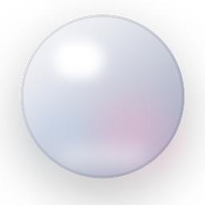
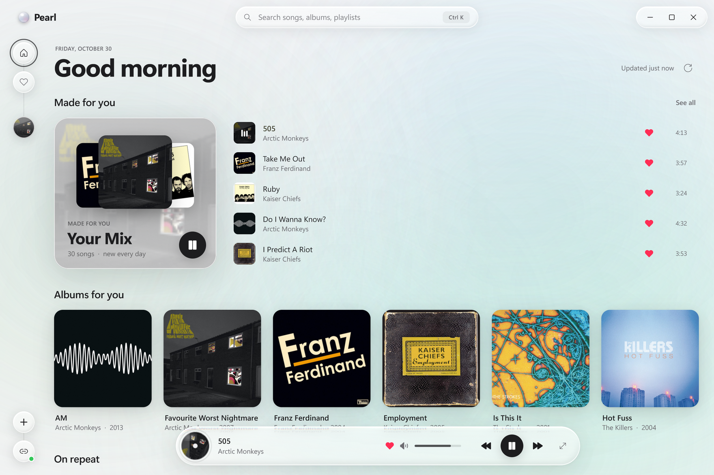
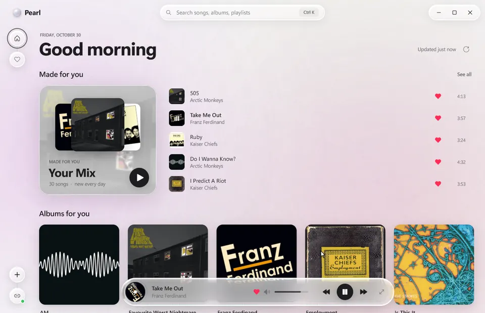
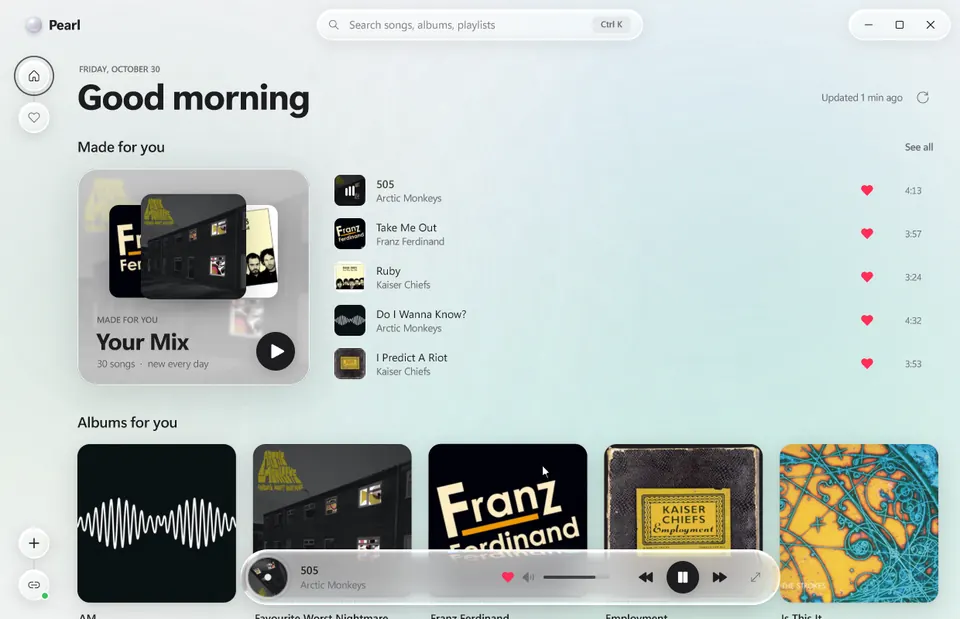
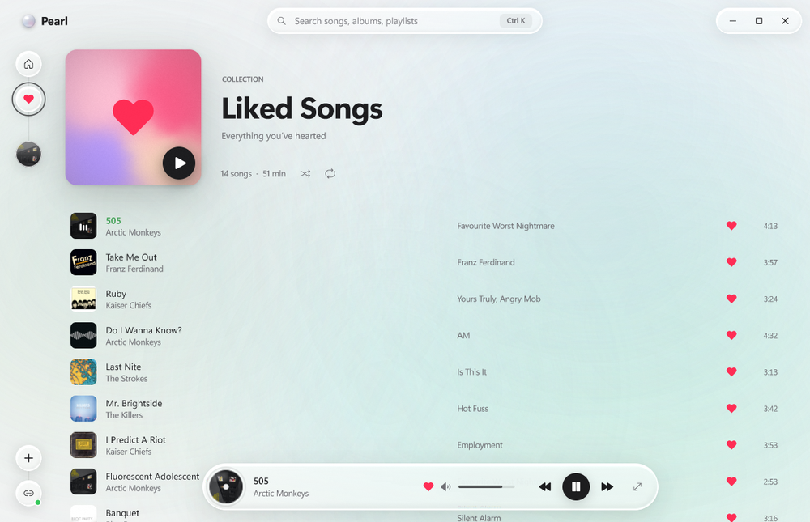
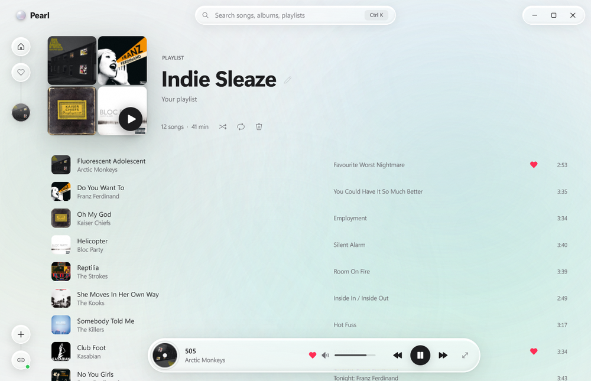
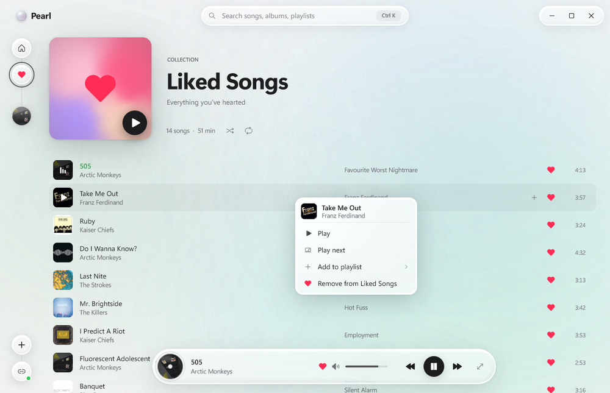
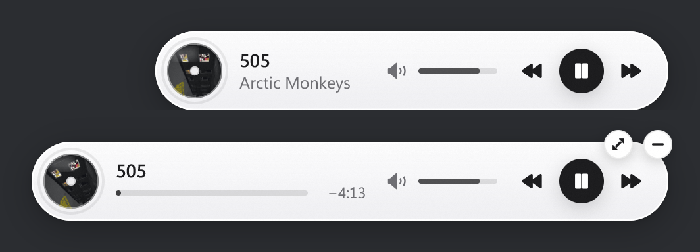
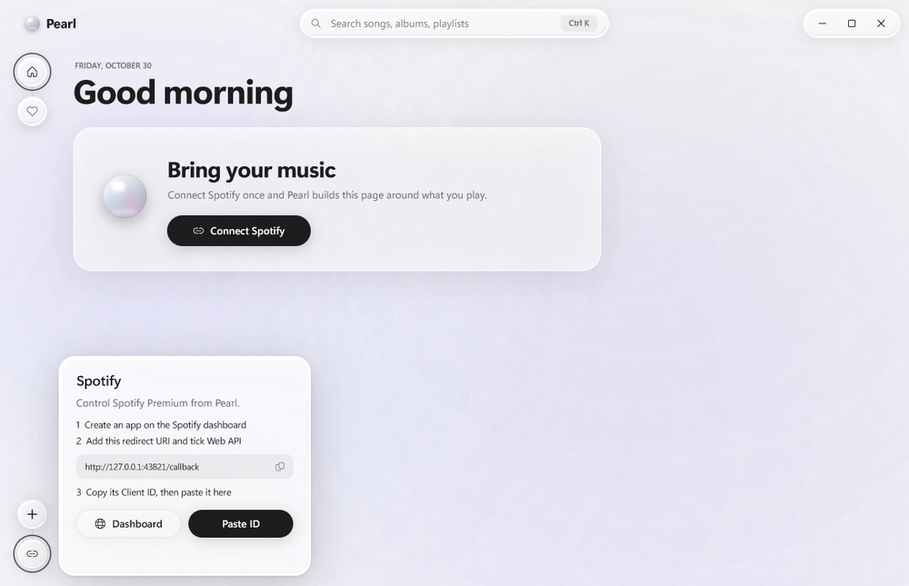

<p align="center">
  
</p>

<h1 align="center">Pearl</h1>

<p align="center">
  A Spotify player for Windows, written from scratch in C++ with its own Direct3D renderer.<br>
  One executable under 1&nbsp;MB. No runtime, no installer.
</p>

<p align="center">
  <a href="https://github.com/nn-nymph/pearl/releases/latest"><b>Download</b></a>
  &nbsp;·&nbsp;
  <a href="#connect-spotify">Connect Spotify</a>
  &nbsp;·&nbsp;
  <a href="#building-from-source">Build from source</a>
</p>

<p align="center">
  
</p>

Pearl controls Spotify through Spotify Connect, so the audio still comes from the Spotify app, your phone or a speaker. Pearl is the part you look at. It builds a home page from what you actually listen to, shows synced lyrics, gives you a player bar you can park anywhere, and has a mini player that sits on the edge of your screen.

## In motion

<p align="center">
  
</p>
<p align="center"><sub>Press play on Your Mix. The player swaps tracks and the background takes its color from the cover.</sub></p>

<p align="center">
  
</p>
<p align="center"><sub>Drag the player bar and let go. It springs to the nearest of five spots and shrinks to a compact pill away from the bottom edge.</sub></p>

## What it does

- **A home page built from your listening.** Pearl reads your top artists, top tracks and recent plays, then lays out a 30-song mix, albums and artists close to what you play, an On repeat shelf, and new releases from artists you play. The page is cached, so it shows up instantly and refreshes in the background.
- **Spotify Connect remote.** Play, pause, skip, seek, volume, shuffle and repeat. If no Spotify device is running, Pearl starts the desktop app minimized and hands playback to it.
- **Now Playing with synced lyrics.** A full-window view with the cover, controls and lyrics from [LRCLIB](https://lrclib.net). The current line stays in focus as the song plays, and clicking any line jumps there.
- **Search** across Spotify for songs, albums and artists. Album pages and artist pages come with top tracks, discography and a short bio from Wikipedia. Paste any Spotify link with <kbd>Ctrl</kbd>+<kbd>V</kbd> to open it.
- **Liked Songs and playlists.** Heart anything, drag a song onto a playlist in the sidebar (or onto **+** to start a new one), or right-click for Play next, Add to playlist and Go to album. These are Pearl's own and never modify your Spotify library.
- **Mini player.** Press <kbd>Insert</kbd> from anywhere to fold Pearl into a floating pill. Throw it toward an edge and it snaps to the nearest of eight spots. Hover it for a seek bar and a button that brings the full window back.
- **Behaves like a Windows app.** Per-monitor DPI, rounded corners and the acrylic backdrop on Windows 11, media keys, a single instance, and it remembers its window, volume and where you left off.

<table>
  <tr>
    <td width="50%"></td>
    <td width="50%"></td>
  </tr>
  <tr>
    <td align="center"><sub>Liked Songs</sub></td>
    <td align="center"><sub>Playlists get a mosaic of their first four covers</sub></td>
  </tr>
  <tr>
    <td width="50%"></td>
    <td width="50%"></td>
  </tr>
  <tr>
    <td align="center"><sub>Right-click any song</sub></td>
    <td align="center"><sub>Mini player, at rest and on hover</sub></td>
  </tr>
</table>

## Getting started

### Requirements

- Windows 10 or 11, 64-bit. The acrylic backdrop needs Windows 11 22H2 or later; older builds get a solid background.
- A CPU with AVX2 (Intel Haswell, AMD Ryzen or newer).
- A GPU with Direct3D 11.
- Spotify Premium. Spotify only allows playback control through its Web API for Premium accounts.

### Install

Download `Pearl.exe` from [Releases](https://github.com/nn-nymph/pearl/releases/latest) and run it. Nothing gets installed. Settings and caches live in `%APPDATA%\Pearl`, so uninstalling means deleting the exe and that folder.

The exe isn't code-signed, so SmartScreen may ask you to confirm the first time you run it.

### Connect Spotify

Pearl doesn't ship with a Spotify client ID. You register your own, which is free and takes about a minute.

1. Open the [Spotify Developer Dashboard](https://developer.spotify.com/dashboard) and create an app.
2. Add `http://127.0.0.1:43821/callback` as a redirect URI and tick **Web API**.
3. Copy the app's **Client ID**.
4. In Pearl, click the link button at the bottom of the sidebar, press **Paste ID**, then **Connect** and approve Pearl in your browser.

<p align="center">
  
</p>

A few things worth knowing:

- New Spotify apps run in development mode. Your own account works right away; anyone else needs to be added under **User Management** in the dashboard.
- Sign-in uses OAuth with PKCE, so there is no client secret.
- The Client ID and refresh token are stored in `%APPDATA%\Pearl\spotify.dat`, encrypted with Windows DPAPI for your user account. They never leave your machine except to talk to Spotify.

### Keyboard shortcuts

| Keys | Action |
| --- | --- |
| <kbd>Space</kbd> | Play / pause |
| <kbd>←</kbd> <kbd>→</kbd> | Seek 5 seconds |
| <kbd>Ctrl</kbd>+<kbd>←</kbd> <kbd>Ctrl</kbd>+<kbd>→</kbd> | Previous / next track |
| <kbd>↑</kbd> <kbd>↓</kbd> | Volume |
| <kbd>M</kbd> | Mute |
| <kbd>L</kbd> | Like the current song |
| <kbd>Ctrl</kbd>+<kbd>K</kbd>, <kbd>Ctrl</kbd>+<kbd>F</kbd> or <kbd>/</kbd> | Search |
| <kbd>Ctrl</kbd>+<kbd>V</kbd> | Open a Spotify link from the clipboard |
| <kbd>Ctrl</kbd>+<kbd>N</kbd> | New playlist |
| <kbd>Esc</kbd> | Close a menu, panel or detail page; leave Now Playing |
| <kbd>Insert</kbd> | Fold Pearl into the mini player; press again to show or hide the pill. Works system-wide. |
| Media keys | Play / pause, next, previous |

### What Pearl connects to

- `accounts.spotify.com` and `api.spotify.com` for sign-in, playback and everything else Spotify
- Spotify's image CDN for cover art
- `lrclib.net` for lyrics
- `en.wikipedia.org` for artist bios

That's the whole list. There are no analytics, no telemetry and no update checks. The listening history Pearl uses for recommendations stays in `%APPDATA%\Pearl`.

## Building from source

You need Visual Studio 2022 with the **Desktop development with C++** workload and the **C++ Clang tools for Windows** component (the project builds with the ClangCL toolset), plus a Windows 10 or 11 SDK for `fxc.exe`.

```powershell
git clone https://github.com/nn-nymph/pearl.git
cd pearl
.\tools\build.ps1                         # build\release\Pearl.exe
.\tools\build.ps1 -configuration Debug    # build\debug\Pearl.exe
.\tools\build.ps1 -rebuild
```

`build.ps1` expects Visual Studio 2022 Community in its default location. With another edition, open `pearl.sln` and build `Release | x64`. Shaders are compiled in a pre-build step (`tools\shaders.ps1`) and embedded in the exe as resources.

Before sending a pull request, run `.\tools\style.ps1`. It checks the house style: tabs, spaces inside parentheses and template brackets, LF line endings, and no comments.

### How it's put together

Pearl doesn't link the C runtime. It has its own entry point, allocator, containers, JSON parser and WinHTTP wrapper, and it builds with exceptions and RTTI turned off.

The UI is immediate-mode. Each frame the app walks its state and records draw lists, and the renderer batches those into Direct3D 11 draws presented through DirectComposition. Text goes through DirectWrite in Segoe UI Variable, and icons come from Segoe Fluent Icons. The glass panels sample a blurred copy of the frame with a slightly different refraction offset per color channel, which is where the soft prismatic edge comes from.

Animation is spring-based throughout. The renderer only draws while something is moving and schedules frames against the display's vblank. When nothing is happening it falls back to a slow background drift, and when the window is hidden it stops drawing entirely.

| Path | What's there |
| --- | --- |
| `src/runtime` | Entry point and allocator (no CRT) |
| `src/base` | Containers, text, math, JSON, file I/O |
| `src/render` | D3D11 device, draw lists, text layout |
| `src/shaders` | UI and glass shader, blur passes, procedural covers for the demo library |
| `src/ui` | App state, pages, widgets, player bar, mini player |
| `src/spotify` | Sign-in, Connect playback, search, the home page's taste engine |
| `src/lyrics` | LRCLIB client and LRC parser |
| `src/audio` | WASAPI output, Media Foundation decoder, synthesizer |
| `src/library` | Local library scan, tags, cover art, demo library |
| `src/net` | HTTP over WinHTTP |
| `src/debug.cc` | Headless capture and benchmark harness (Debug builds only) |

### Headless capture

Debug builds include a scripted renderer that runs without a window. Every image in this README came out of it.

```powershell
.\build\debug\Pearl.exe --capture shot --size 1240x800 --scale 2 --script "page albums; wait 1; shot albums"
```

That writes `shot_albums.png`. Scripts can click, drag, scroll, type and navigate, and `bench 600` writes the average frame time over 600 frames. Without `--folder <path>`, the harness loads a built-in demo library of procedurally painted albums with synthesized songs.

## Status

- **Local files.** The folder scanner, tag reader, Media Foundation decoding and WASAPI output are all in the tree, but there's no folder picker in the UI yet. Debug builds accept `--folder <path>`.
- **Likes and playlists** live in Pearl and don't sync to your Spotify library.
- **Windows x64 only.**

## Acknowledgements

Lyrics come from [LRCLIB](https://lrclib.net) and artist bios from the [Wikipedia REST API](https://en.wikipedia.org/api/rest_v1/). Pearl is an independent project and isn't affiliated with or endorsed by Spotify.
